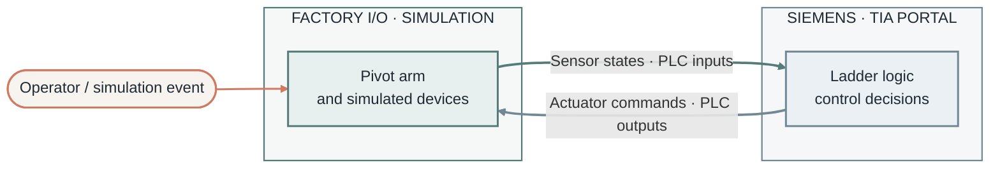

# Pivot Arm | Factory I/O + Siemens TIA Portal

> **Level 1 PLC project** — a hands-on tutorial for modeling a pivot arm and its I/O control logic.

## Project overview

This project explores a **pivot-arm mechanism** through a Factory I/O scene and PLC logic developed with Siemens TIA Portal. It is intended as a Level 1 learning exercise: connect a simulated industrial mechanism to controller inputs and outputs, then use ladder logic to define how the mechanism should respond.

The repository currently contains a Factory I/O project file and a `Pivot Arm` folder for project materials. The exact scene configuration, tag names, sequence, and PLC hardware settings should be confirmed against those files before being documented in detail.

## Why this project matters

Pivoting and positioning mechanisms appear in automated production wherever an item, tool, or fixture must move between positions. Practicing with a simulated cell gives learners a way to understand the relationship between **field signals, PLC decisions, and machine motion** before working with physical equipment.

This project is a learning model, not a validated production control design. Real installations require suitable guarding, interlocks, risk assessment, commissioning, and site-specific engineering.

## System at a glance

The intended information path is:

1. A simulated event or sensor state is represented as a PLC input.
2. Ladder logic evaluates the input conditions and the control state.
3. PLC outputs command the simulated actuator or mechanism.
4. The Factory I/O scene reflects the resulting movement and device states.

> The diagram describes the usual Factory I/O–PLC workflow. Check the project files to verify the actual driver, signal mapping, and sequence used here.

## Data and signal organization

| Layer | What it represents | Examples to document from the project |
|---|---|---|
| Simulated devices | Mechanism and sensors in the Factory I/O scene | Pivot arm, position sensors, presence sensors |
| PLC inputs | States read by the controller | Start/stop commands, sensor feedback |
| PLC logic | Conditions and sequence decisions | Permissives, movement steps, reset behavior |
| PLC outputs | Commands sent to the scene | Extend/retract or position commands |
| Feedback | Confirmation that an action completed | End-position or cycle status |

**Address and tag map:** add the real Factory I/O tags and TIA Portal PLC addresses here once verified. No I/O addresses are inferred in this README.

## Industrial relevance

- **Material handling:** divert or position objects between stations.
- **Assembly cells:** move a fixture or tool into a working position.
- **Packaging lines:** guide or transfer products through a process step.
- **Machine tending:** coordinate a pivoting mechanism with sensors and other equipment.

These are examples of where similar mechanisms may be used; they do not imply that this tutorial implements each application.

## Repository contents

| Path | Purpose |
|---|---|
| `Pivot Arm/` | Supporting project materials (inspect folder contents for details) |
| `Pivot Arm.factoryio` | Factory I/O scene/project file |
| `README.md` | Project guide and documentation |

## Getting started

1. Open `Pivot Arm.factoryio` in Factory I/O and inspect the scene and its configured I/O driver.
2. Open the corresponding Siemens TIA Portal project from `Pivot Arm/`, if included.
3. Confirm that PLC tags and Factory I/O signals use matching addresses.
4. Run the simulation and observe input, logic, and output behavior.

> TIA Portal project availability and exact run steps depend on the files included in `Pivot Arm/`.

## Learning outcomes

- Read a simulated automation scene as a set of devices and signals.
- Trace input-to-logic-to-output behavior in a PLC program.
- Relate ladder logic to motion in a virtual industrial cell.
- Organize and document an I/O map and basic sequence.

## Project profile

**Domain:** Industrial automation · **Controller environment:** Siemens TIA Portal · **Simulation:** Factory I/O · **Level:** 1

---

Professional profile palette: charcoal, muted teal, and warm coral.
