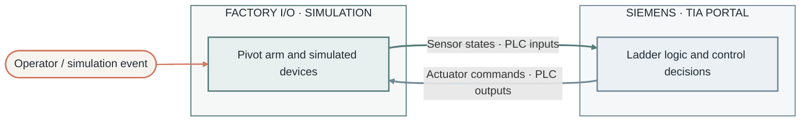
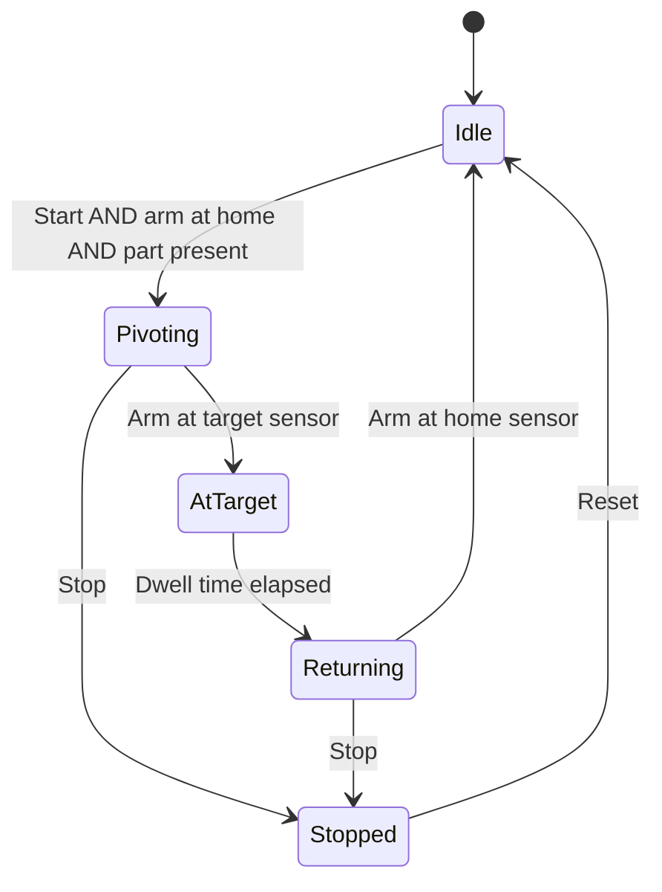

# Pivot Arm | Factory I/O + Siemens TIA Portal

> **Level 1 PLC project** — a hands-on tutorial for controlling a simulated pivot arm with ladder logic.

<!-- TODO: add a screenshot or GIF of the running scene -->

## Table of contents

- [Project overview](#project-overview)
- [Requirements](#requirements)
- [Repository contents](#repository-contents)
- [Getting started](#getting-started)
- [System at a glance](#system-at-a-glance)
- [I/O address map](#io-address-map)
- [Operating sequence](#operating-sequence)
- [Ladder logic](#ladder-logic)
- [Troubleshooting](#troubleshooting)
- [Learning outcomes](#learning-outcomes)
- [Industrial relevance](#industrial-relevance)
- [Safety note](#safety-note)
- [Author and license](#author-and-license)

## Project overview

This project controls a **pivot-arm mechanism** in a Factory I/O scene using ladder logic written in Siemens TIA Portal. It is a Level 1 exercise: you connect simulated sensors and actuators to PLC inputs and outputs, then program how the arm responds to start/stop commands and position feedback.

**What the arm does:** `<describe in one or two sentences, e.g. "pivots from position A to position B when a part is detected, then returns to home">`

## Requirements

| Component | Version / model |
|---|---|
| Factory I/O | `<version>` |
| Siemens TIA Portal | `<version, e.g. V17 / V18 / V19>` |
| PLC | `<e.g. S7-1200 CPU 1214C / S7-1500 CPU 1511>` |
| PLC simulator | `<PLCSIM / PLCSIM Advanced>` |
| Factory I/O driver | `<e.g. Siemens S7-PLCSIM / S7-1200/1500 (TCP/IP)>` |
| Operating system | Windows 10/11 (64-bit) |

## Repository contents

| Path | Purpose |
|---|---|
| `Pivot Arm.factoryio` | Factory I/O scene |
| `Pivot Arm/` | Siemens TIA Portal project (`.ap##` archive or project folder) |
| `docs/images/` | Screenshots and GIFs used in this README |
| `README.md` | Project guide |
| `LICENSE` | License terms |

## Getting started

1. Open `Pivot Arm/` in TIA Portal and load the project (`<file name>`).
2. Compile the PLC program and download it to the simulated PLC (PLCSIM).
3. Set the PLC to **RUN**.
4. Open `Pivot Arm.factoryio` in Factory I/O.
5. In **File → Drivers**, select the driver listed in [Requirements](#requirements) and click **Connect**. The status indicator should turn green.
6. Press **Run** in Factory I/O, then use the scene's start/stop controls.

The tag names in Factory I/O match the PLC addresses listed in the [I/O address map](#io-address-map). If you change one side, update the other.

## System at a glance

Signal flow per scan cycle:

1. Factory I/O sends sensor states and operator commands to the PLC inputs.
2. Ladder logic evaluates the inputs and the current sequence state.
3. PLC outputs command the arm.
4. Factory I/O moves the arm and updates the sensors.

## I/O address map

> Fill in from the actual Factory I/O scene and TIA Portal tag table.

### Inputs (Factory I/O → PLC)

| Signal | Description | Factory I/O tag | PLC address | Type |
|---|---|---|---|---|
| Start | Start push button | `<tag>` | `%I0.0` | BOOL |
| Stop | Stop push button (NC) | `<tag>` | `%I0.1` | BOOL |
| Reset | Reset push button | `<tag>` | `%I0.2` | BOOL |
| Arm at home | Position sensor, home | `<tag>` | `%I0.3` | BOOL |
| Arm at target | Position sensor, end of travel | `<tag>` | `%I0.4` | BOOL |
| Part present | Presence sensor | `<tag>` | `%I0.5` | BOOL |

### Outputs (PLC → Factory I/O)

| Signal | Description | Factory I/O tag | PLC address | Type |
|---|---|---|---|---|
| Pivot forward | Move arm toward target | `<tag>` | `%Q0.0` | BOOL |
| Pivot return | Move arm back to home | `<tag>` | `%Q0.1` | BOOL |
| Run lamp | Cycle running indicator | `<tag>` | `%Q0.2` | BOOL |

The addresses above are an example layout. Replace them with the real ones from the project.

## Operating sequence

<!-- TODO: adjust states and conditions to match the actual program -->

| Step | State | Condition to enter | Outputs active |
|---|---|---|---|
| 0 | Idle | Power-up, or return completed | None |
| 1 | Pivoting | Start, arm at home, part present | Pivot forward |
| 2 | At target | Target sensor reached | None (dwell timer running) |
| 3 | Returning | Dwell time elapsed | Pivot return |
| 4 | Stopped | Stop pressed | None, reset required |

## Ladder logic

<!-- TODO: add a screenshot of OB1 / main network -->

| Block | Role |
|---|---|
| `OB1 (Main)` | `<cyclic call of the sequence>` |
| `<FC/FB name>` | `<sequence / state machine>` |
| `<Tag table>` | `<I/O and internal tags>` |

## Troubleshooting

| Problem | Likely cause | Fix |
|---|---|---|
| Factory I/O driver will not connect | PLC not in RUN, wrong driver, or wrong PLCSIM instance name | Put the PLC in RUN, re-check the driver and instance name |
| PLC runs but the arm does not move | Tags/addresses do not match, or outputs not mapped | Compare Factory I/O tags with the PLC tag table |
| Inputs always read 0 | PLCSIM and Factory I/O using different instances | Select the same PLCSIM instance in both |
| Arm moves but never stops | Sensor tag mapped to the wrong address | Check the position sensor addresses in the map above |
| "Access protection" error on S7-1200/1500 | PUT/GET not enabled | Enable *Permit access with PUT/GET* in the CPU properties |
| Program compiles but download fails | Interface mismatch | Select the PLCSIM interface in the download dialog |

## Learning outcomes

- Read a simulated automation scene as a set of devices and signals.
- Build and document an I/O map.
- Write a basic sequence in ladder logic (start, move, dwell, return, stop, reset).
- Trace input → logic → output behavior in a running program.
- Diagnose common PLC-to-simulator connection problems.

## Industrial relevance

The same pattern (sense a position, decide, drive an actuator, confirm the end position) is used in:

- **Material handling:** diverting or positioning objects between stations. In this project: the arm moves a part between two positions.
- **Assembly cells:** moving a fixture or tool into a working position. In this project: the home/target position logic.
- **Packaging lines:** transferring products through a process step. In this project: the presence-sensor-triggered cycle.

## Safety note

This is a learning model, not a validated production control design. Real installations require guarding, interlocks, emergency stop circuits, risk assessment, and commissioning.

## Author and license

- **Author:** `<your name>` — `<GitHub / LinkedIn link>`
- **Contributions:** issues and pull requests are welcome.
- **License:** MIT — see [`LICENSE`](LICENSE).

---

Professional profile palette: charcoal, muted teal, and warm coral.
